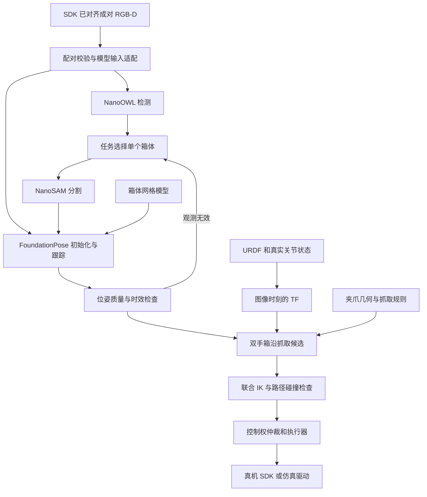

# 轮式双臂机器人 RGB-D 自主抓箱开发方案

**当前开发模式（2026-10-16 更新）：真机故障期间，默认只运行纯仿真。** `tools/grasp/environment run` 使用真实 URDF 的相机安装变换、Isaac 渲染 RGB-D 和仿真关节状态，再运行实际模型感知、抓取点、联合 IK 与仿真执行；不请求真机。默认配置为 `config/grasp/runtime.sim.json`，SDK 接口保留供未来显式 `--source sdk` 迁移。下文真实传感器采集、反馈时效和升降零点要求属于硬件接入方案，不是当前仿真前置条件。实际运行与实现边界以 [运行 README](../tools/grasp/README.md) 为准。

本文面向感知、机器人控制及集成开发人员，定义现有 `wheel-robot` 仿真工程与 `lift_robot_ros2` 真机 SDK 的协作方式。采用 RGB-D 箱体检测与分割、FoundationPose 位姿估计、几何抓取规则和联合运动学求解，完成标准周转箱的自主抓取。

文档日期：2026-10-16，接口修订版 3。真机 SDK 核对基线为 `ba0c7320cd1499995cfc614e83c0c3963343e15a`。接收端协议以该版本的 `docs/RECEIVER_INTEGRATION_ZH.md`、`DEPTH_OUTPUT_ZH.md` 和源码为准；本版本已更新成对 RGB-D 接口，不再以此前下载的旧版手册作为最新契约。本文的新增目录、话题、配置和状态机属于待开发设计，不表示当前仓库已具备这些功能。

本次调整重点：直接复用 SDK 已实现的成对 RGB-D、对齐深度、UART 升降和底盘/升降本机 external 协议。传感器到机器人底座的坐标关联直接采用现有整机 URDF，不把重新标定安装外参列为开发前置条件。重点开发接收端、模型输入适配、分割、位姿估计、几何抓取点、联合 IK 和双臂自主执行入口。

SDK 部署记录表明三台对齐相机及 18030 网关已常驻运行，完成三路短时并行和局域网接收验证。2026-10-16 开发验证另行只读访问了真实网关并取得头部 RGB-D；未复测三路持续在线。上述记录不等于长期稳定性、精确三维测量或自主抓取验收。

首期交付目标是：使用真实安装视角的单台 RGB-D 相机，在箱体改变位置和朝向后自动定位，输出机器人坐标系下的双手抓取姿态，先完成预抓取验证，再完成单箱夹持和试抬。现阶段不依赖激光雷达，不新增真机不存在的传感器。

## 当前实现进度

当前阶段为 **仿真 RGB-D／关节状态＋实际模型推理＋Isaac Sim 执行验证**。相机安装关系采用真实 URDF，内参使用显式仿真配置；不连接 SDK 网关，不依赖真机反馈。采集与执行复用同一场景及已稳定的底座状态，感知只读取 RGB-D，箱体真值单独保存供评估。SDK 采集模式仅保留为未来迁移选项。

SDK 已作为 `third_party/lift_robot_ros2` Git 子模块固定到本文基线。隔离环境、模型来源／校验和迁移步骤见 [抓箱环境 README](../tools/grasp/README.md)。

环境核对补充：宿主机及新建 `.venv` 未配置 ROS，但本机已有 `wheel-robot-fast-livo2:humble` 等 ROS 镜像，已在该镜像中验证 Humble 的 `rclpy` 可导入；不能把宿主环境缺 ROS 表述为整个项目没有 ROS。该既有定位镜像不代表新增抓箱 ROS 包已构建验证，也不意味着抓箱需要引入激光雷达。

2026-10-16 已新增 `ros2_ws/src/wheel_grasp_core`、`wheel_grasp_interfaces`、`config/grasp`、`tools/grasp` 和 `tests/grasp`。逻辑模块先集中在独立可测试的 Python 核心包内；本文后续目录树仍是完整目标架构，不表示所有规划包已建成。

已实现成对接收/回放、仿真 RGB-D 采集、URDF 动态变换、实际模型分割与位姿估计、箱沿目标、升降与双臂联合 IK、仿真轨迹执行、接触拦截和逐轮日志。独立推理镜像、三个 TensorRT 引擎和模型推理已验证。当前执行验证范围是准备动作及预抓取／抓取位姿接近，尚不包含夹紧、试抬和搬运验收；规划结果不能直接用于真机。历史 SDK 采样只作为接口排查记录，不作为当前仿真运行依赖。

具体安装、命令、已实现接口和未完成事项见 [核心运行说明](../ros2_ws/src/wheel_grasp_core/README.md)。

## 1 当前工程基础与差距

### 1.1 已有仿真能力

| 内容 | 现有位置 | 可复用内容与边界 |
| --- | --- | --- |
| 整机 URDF | `assets/robots/r680_lift_openarm/r680_lift_openarm_sim.urdf` | 底盘、升降、双臂、相机安装关系；入口由 `config/robot_config.json` 指定 |
| 机器人驱动目标 | `scripts/robot_control.py` | 全向轮运动学、关节限位及限速；当前写入 Isaac 驱动，不是实机驱动 |
| 双臂及升降 IK | `scripts/whole_body_control.py`、`gpu_whole_body_ik.py` | 联合求解末端目标；不等于完整动力学或碰撞规划 |
| 箱体感知 | `scripts/relay_perception.py` | 几何拟合和质量检查；当前依赖理想实例标签、场景先验和额外构造的深度观察视角 |
| 抓取规则 | `scripts/relay_runtime.py` 的 `hand_targets()` | 两侧箱沿中点、夹爪姿态、预抓取生成 |
| 搬运状态机 | `scripts/relay_runtime.py`、`relay_task.py` | 接近、夹紧、试抬、搬运与异常处理；包含仿真专用接口 |
| 单机搬运 | `scripts/transport_runtime.py`、`transport_task.py`、`floor_demo.py` | 历史流程及测试参考，不作为新感知系统的唯一入口 |
| 导航 | `scripts/grid_navigation.py`、`navigation_runtime.py` | 已知地图 A*；历史激光链路不能视为现有真机能力 |

完整 URDF 是机器人运动学和安装几何的主要来源，但模型配置内的仿真增益、摩擦、驱动力等不自动成为真机参数。接力仿真还使用 AG95 替代夹爪，必须核对真机实际夹具和 TCP，不能直接套用其抓取偏移。

### 1.2 真机 SDK 已有能力

SDK 地址：<https://gitee.com/fxx360724/lift_robot_ros2>。

| SDK 模块 | 已有职责 | 自主抓取接入差距 |
| --- | --- | --- |
| `Project/device_adapters` | OpenArm CAN、R680 CAN、UART 升降、SDK frameset 成对 RGB-D 节点 | 复用已对齐 RGB-D 与升降驱动；补模型输入几何适配、URDF TF 和远端控制桥接 |
| `Project/arm_motion` | 双臂 IK，约 33 ms 更新 | 使用固定 OpenArm 模型，不是完整轮式机器人模型 |
| `Project/control_manager` | 双臂控制和 shared 整机使能/顺序停放、限速及超时 | shared 仍依赖 Quest；双臂自主轨迹和跨设备协调模式待扩展 |
| `Project/robot_description` | 固定 OpenArm MJCF 与坐标约定 | 未接入完整底盘、升降及相机外参链 |
| `Project/robot_interfaces` | 双臂状态、目标、命令及相机帧消息 | 需要增加自主任务与感知接口，不直接改变旧消息语义 |
| `Project/data_recorder` | 真实状态、命令、图像录制及回传 | 扩展深度、TF、位姿及抓取结果记录 |
| `Project/luxi_web_ctrl` | HTTP 状态、原子 RGB-D、深度/内参/像素查询和既有控制服务 | 复用数据接收；无任意双臂轨迹、HTTP 升降绝对目标接口 |

现有 SDK 链路为 `/luxi/targets → /luxi/intent → /luxi/command → 硬件适配器`。其中目标坐标为 `arm_origin`，关节状态和命令数组为 `right[8], left[8]`，`valid` 和 `grippers` 数组同样是右、左顺序。必须通过显式映射转换，不能按数组直觉接线。

`/luxi/applied` 表示提交给驱动的命令，不代表实际到位；实际位置必须读取 `/luxi/arms/state`。底盘反馈提供速度、IMU 和电压，不提供全局定位真值。

### 1.3 相机模型和设备身份

当前 URDF 中有以下真实节点：

| 角色 | 安装链接 | RGB 光学坐标系 |
| --- | --- | --- |
| 头部 | `head_d455_link` | `head_d455_color_optical_frame` |
| 左腕 | `left_wrist_eb435i_link` | `left_wrist_eb435i_color_optical_frame` |
| 右腕 | `right_wrist_eb435i_link` | `right_wrist_eb435i_color_optical_frame` |

头部相机固定在 `base_link`；左腕安装在 `openarm_left_ee_base_link`，右腕按对应 URDF 链计算。头部安装关节给出的 `xyz` 为 `[0.183562318, 0.047725407, 0.909236443]` m，`rpy` 为 `[0, 0.745022486, 0.002466441]` rad。代码应解析 URDF，不再复制这些数值作为另一份参数源。

SDK 配置为 D455f 和两台 D435i，新深度后端兼容 USB/ASIC 与 SDK 主序列号两种身份。不得把两种序列号误认为两台设备。

| 相机 ID | USB/ASIC 序列号 | RealSense SDK 主序列号 |
| --- | --- | --- |
| `head_rgb` | `261043062235` | `260922304036` |
| `left_wrist_rgb` | `254843065015` | `244622073011` |
| `right_wrist_rgb` | `261443062039` | `262422075883` |

软件角色仍需和真实安装位置核对。SDK 的 D435i 配置与 URDF 的 EB435i 腕部命名差异仍需处理。SDK 对齐模式 frame 为 `{id}_color_optical`，原生模式为 `{id}_depth_optical`；适配器按模式映射到 URDF 对应光学 frame，不能混用深度 frame 与彩色 frame。

按用户确认的整机真实 URDF 直接建立安装几何链：SDK 相机 ID/设备序列号映射到头部、左腕和右腕角色，再绑定上述 URDF 光学 frame。EB435i/D435i 的历史命名差异记录在映射配置中，不据此阻塞 URDF 接入或要求重新进行安装标定。实现时检查坐标轴、单位和零位的一致性；相机成像畸变及 SDK 深度数值语义另在输入适配层处理。

## 2 项目目录结构

### 2.1 当前仓库结构

以下是现有顶层目录及主要职责，文件清单按模块归并。

```text
wheel-robot/
├── README.md                       # 项目入口与部署说明
├── VALIDATION.md                   # 历史验证记录
├── config/                         # 机器人、场景、任务、导航配置
│   ├── robot_config.json           # 主 URDF 入口
│   ├── relay_robot_config.json
│   ├── relay_config.json
│   ├── relay_demo_config.json       # 现有抓取参数
│   ├── navigation_demo_config.json
│   └── profiles/                   # 固定立柱与升降配置
├── scripts/                        # 现有 Isaac 控制与业务实现
│   ├── robot_control.py
│   ├── arm_ik.py
│   ├── whole_body_control.py
│   ├── gpu_whole_body_ik.py
│   ├── relay_perception.py
│   ├── relay_runtime.py
│   ├── relay_task.py
│   ├── transport_runtime.py
│   ├── grid_navigation.py
│   ├── navigation_runtime.py
│   ├── run_relay_scene.py
│   ├── simctl
│   └── web/                        # 现有网页控制台
├── tests/                          # 运动学、任务、感知、控制台回归
├── docs/                           # 开发与部署文档
├── docker/                         # 仿真和历史定位镜像定义
├── compose*.yaml                    # 现有服务编排
├── assets/                         # 本地外部资产，不入库
│   ├── robots/r680_lift_openarm/    # 整机 URDF 与网格
│   ├── robots/generated/           # 机器人生成资产
│   └── generated/                  # 场景生成资产
├── third_party/                    # 外部源码，不入库
├── outputs/                        # 日志、报告、截图，不入库
├── video/                          # 录屏，不入库
└── .runtime/                       # 容器和运行缓存，不入库
```

### 2.2 建议新增结构

在现有工程增加 ROS 2 工作空间；保留原仿真入口作为回归基线。目录中的文件名为开发目标，尚未创建。

```text
wheel-robot/
├── ros2_ws/
│   └── src/
│       ├── wheel_grasp_interfaces/ # msg、action、srv
│       ├── wheel_robot_description/# 整机模型安装、TF、关节映射
│       ├── wheel_sensor_bringup/   # 复用成对 RGB-D、投影模型适配、时间检查
│       ├── wheel_receiver/         # 接收端 HTTP/ROS 采集与有界缓存
│       ├── wheel_crate_perception/# 检测、分割、位姿、质量检查
│       ├── wheel_grasp_planner/    # 箱沿目标、双手候选、IK、碰撞检查
│       ├── wheel_grasp_executor/   # 任务阶段、轨迹执行、抓持判定
│       ├── wheel_sdk_bridge/       # 机器人本机：租期、控制权、SDK 适配
│       ├── wheel_sim_bridge/       # Isaac 图像、关节、执行接口
│       └── wheel_grasp_bringup/    # sim、replay、hardware 分环境启动
├── config/grasp/
│   ├── sensors.yaml               # 两类序列号、SDK frame 到 URDF frame 映射
│   ├── receiver.yaml              # BASE_URL、HTTP/ROS、域、QoS、超时
│   ├── lift_mapping.yaml          # 设备微米坐标与 URDF 零点/方向/边界
│   ├── joint_mapping.yaml         # URDF ↔ SDK 关节及方向/零点
│   ├── crate_models.yaml          # 模型 ID、路径、坐标原点、对称性
│   ├── grasp_rules.yaml           # 接触点、TCP、接近姿态
│   ├── perception.yaml            # 模型后端、有效性与跟踪参数
│   ├── execution.yaml             # 速度、超时、执行模式
│   └── runtime.lock.yaml          # 实测通过的软件/模型/资产版本
├── tests/grasp/
│   ├── unit/                      # 坐标、单位、关节与抓取规则
│   ├── replay/                    # 录制数据的确定性回放
│   └── integration/               # 感知、执行、故障和控制权测试
├── tools/grasp/
│   ├── validate_model.py          # URDF、mesh、TCP 一致性检查
│   ├── record_dataset.sh
│   ├── replay_dataset.sh
│   └── evaluate_grasp.py
└── docs/RGBD_GRASP_DEVELOPMENT.md
```

接收端运行 `wheel_receiver`、感知与规划；机器人本机运行 `wheel_sdk_bridge`、反馈汇总和控制执行。即使接收端只用 HTTP，运动桥接也必须位于机器人本机，不能在远端生成驱动本机单调时钟。HTTP 适合首次只读联调；连续感知优先使用已配置好 DDS 的 ROS 数据流。

每个 ROS 包包含 `package.xml`、构建配置、源码、测试和简短 README。部署节点优先 C++17；Python 用于模型对照、离线评估和现有 IK 原型复用。不要为了语言统一先重写已验证算法。

### 2.3 SDK 与模型依赖管理

SDK 维护为独立源码仓库，通过固定 commit 的依赖清单导入；可放在本地 `third_party/lift_robot_ros2/`，但不重复提交其源码。SDK 修改在对应仓库提交并固定版本，本工程保存接口版本和集成测试。

模型权重、TensorRT 引擎、CAD 和数据集存放在外部资产目录，清单记录 URL、commit、SHA-256、许可证、构建环境。TensorRT 引擎按目标 GPU 和运行环境构建，不默认跨硬件复用。

整机 URDF 使用单一来源。ROS 包通过构建安装或资源准备步骤取得该模型及网格，避免长期维护两份不同 URDF；记录来源和校验值。

## 3 总体技术路线



该路线输出箱体位姿后按规则计算抓取点，并不让通用模型直接预测双臂接触组合。首期固定底盘完成抓取，以底座为规划参考系，不要求先解决整机全局定位。

## 4 RGB-D 和坐标系统

### 4.1 直接使用 SDK 成对 RGB-D

新版 `realsense_depth` 默认 `align_to_color=true`，在一个进程中取得 RGB/深度 frameset 并调用 `rs2::align(RS2_STREAM_COLOR)`。不再自行开发像素对齐算法，也不在业务端将独立 RGB 与深度快照拼接成样本。默认 RGB 和深度均为 640×480、15 Hz，实际以元数据为准。

同组输出 JPEG RGB、32FC1 米制小端深度和网格内参，共享主机 ROS stamp、`{id}_color_optical` 及 sequence。`pair_id` 是不透明会话/序号标识，用 camera_id/pair_id 去重；重启后生成新标识。有效像素可按同一 `(u,v)` 查询，NaN 仍表示无测量。mask 不必每个像素都有深度，更不能通过补满 mask 伪造几何。

`pairing=sdk_frameset`、`hardware_synchronized=false`：像素对齐不等于硬件曝光同步。保留两路设备帧号、时间域和时间戳，仅在时间域一致时计算差值。首期静止相机与箱体；运动腕部观测需评估图像采集到关节反馈的时差。

一个对齐进程占用该相机的 RGB 和深度传感器；不得与旧 V4L2 RGB 或其他深度进程并行竞争。对齐服务已经部署时直接订阅，不重复启动。SDK 后端入口为 v3，更新时主程序、后端和包含 RGBDFrame 的接口包必须一起构建。

### 4.1.1 HTTP 原子接收

SDK 记录的已部署网关为 `http://192.168.0.245:18030`；部署配置保留可修改 BASE_URL，实际连接时核对版本和状态。以下接口已存在：

| 接口 | 使用方式 |
| --- | --- |
| `GET /api/cameras/{id}/rgbd` | 主入口；一次响应取得同组 metadata、color、depth |
| `GET /api/cameras/{id}/rgbd/info` | 状态诊断；不可用其旧元数据解释另一次 rgbd 响应 |
| `GET /api/state` | 检查 cameras[id].rgbd.fresh、设备及控制状态 |
| 旧 RGB、depth、depth/info 接口 | 兼容与诊断；独立请求不能证明同组 |

复用 SDK `Project/luxi_web_ctrl/scripts/receive_rgbd.py` 的 MIME 解码逻辑。响应为 `multipart/mixed`，包含 metadata JSON、color JPEG、depth 二进制三个部分，不以字符串换行拆二进制。返回的 OpenCV 图像为 BGR，送入要求 RGB 的模型前转换通道顺序。

接收端必须验证：schema 为 luxi_rgbd_v1；aligned_to_color=true；相机 ID、响应 X-Pair-Id 与 metadata 一致；mock=false；图像尺寸相等；深度编码 32FC1、unit=metre、little-endian、step=width×4、字节数 width×height×4；calibration_available=true。保留 ros_projection_compatible、畸变模型和深度 value semantics，不能只读取 K。

404 检查旧网关或路径；503 为无新鲜成对数据，不回退到独立快照拼接。服务端 1 秒超时仅为传输门槛，执行器仍检查自身观测期限。队列有界，去重后处理最新完整组。64 位序号和时间字符串使用 int/BigInt，不经浮点丢失精度。

### 4.1.2 ROS 整组订阅

优先订阅 `/luxi/cameras/{id}/rgbd`，类型 `luxi_interfaces/msg/RGBDFrame`，SensorDataQoS（best effort/volatile）。包含 header、camera_id、pair_id、sequence、depth_device_sequence、color_device_sequence、color/depth CameraFrame 和 camera_info。接收端重建新版接口包，不能沿用旧消息定义。

保留标准 `/camera/{id}/image/compressed`、`depth/image_raw`、`depth/camera_info` 和 `color/camera_info` 作诊断；ROS Image 按 step/is_bigendian 解码。生产感知优先整组入口，避免独立话题到达顺序引入错误配对。

双臂用 `/luxi/arms/state`；升降、底盘用各自 `/luxi/{lift,base}/state` 与 status，测量有效性和运动许可分别判断。整机 JointState 仍需新增汇总器。

当前板端默认 local-only；跨机 ROS 要双方配置 `ROS_LOCALHOST_ONLY=0`、一致 ROS 域和 DDS 网络。HTTP 接收不要求开放 DDS。一路默认深度纯像素约 18.4 MB/s，三路约 55.3 MB/s，另加 JPEG 与协议开销；首期只订阅主相机，后续再增加腕部复核。

### 4.1.3 FoundationPose 输入适配

已对齐使 mask 与深度在像素上对应，但并不自动证明它们满足任意位姿实现的三维投影假设。新增 `pose_input_adapter`，输出图像、可用深度、K、有效 mask、光学 frame、pair_id 及几何语义标记，处理两件事：

1. **畸变模型。** SDK 实测头部含非零 Inverse Brown Conrady，以 `realsense_2` 表达，ros_projection_compatible=false；腕部零畸变以 plumb_bob 表达。不得将 realsense_2 系数直接当普通 OpenCV Brown 系数。按对应 RealSense 模型建立去畸变/投影映射，RGB、深度及 mask 使用一致的网格；输出与新网格一致的 K。零畸变输入无需多做一次变换。
2. **深度 Z 语义。** SDK 声明 `source_depth_z_resampled_to_color`，即源深度 Z 重采样至彩色网格；不能不经验证就认为它严格等于彩色相机坐标的 Z。FoundationPose 常见针孔反投影需要同一相机系的 Z。对照实测检查近似误差是否满足箱沿抓取预算；未通过时在 SDK 侧补充原始深度/标定链或输出严格彩色坐标 Z/XYZ，再接入位姿。该事项是数据几何适配，不是重新标定机器人安装外参。

原始成对数据可以立即用于分割、有效深度统计和离线位姿试验；几何假设未经验证时只输出诊断结果，不标记为真机可执行位姿。RGB 畸变与深度语义两项分别报告，不以检测成功代替测量验收。

SDK 实测腕部当时场景有效深度约 1%–2%，不代表所有抓取场景都是该比例；对目标 mask 内的有效深度分布进行检查，视野不适合时换主相机或调整实际观察姿态，不构造额外虚拟传感器。


### 4.2 直接以现有 URDF 建立坐标链

整机安装参数唯一来源为 `config/robot_config.json` 指向的 `assets/robots/r680_lift_openarm/r680_lift_openarm_sim.urdf`。不新增一套手填相机安装外参，不将手眼标定作为本开发阶段前置任务。

固定映射：

| SDK 对齐图像 frame | 统一采用的 URDF frame |
| --- | --- |
| head_rgb_color_optical | head_d455_color_optical_frame |
| left_wrist_rgb_color_optical | left_wrist_eb435i_color_optical_frame |
| right_wrist_rgb_color_optical | right_wrist_eb435i_color_optical_frame |

映射器记录设备身份和 frame 别名；按对应坐标轴定义统一 frame，安装矩阵从 URDF 解析，不从字符串推断。若输出经虚拟针孔校正，记录该校正网格与原光学 frame 的关系。

头部 `head_d455_mount_joint` 固定在 base_link，整条固定变换可直接计算。腕部从 base_link 经升降、相应机械臂到相机光学 frame，使用观测对应的实际升降和关节反馈计算。SDK 无整机 JointState，由新增汇总器建立具名状态并发布 TF，不补零伪造无效反馈，不把底盘三轴速度当轮关节。

`robot_state_publisher` 是机器人 TF 的唯一发布者；SDK 若只输出 frame 标签，由桥接统一命名；避免多节点发布同一条 TF。开发测试核对 URDF 链连通、单位、轴向和反馈映射，不重复测定 URDF 已提供的安装位置。

当前图像 stamp 是接收/处理时间，不是曝光时间。首期静止观测减小时间偏差；腕部运动时保留时间质量和关节插值误差。不同机器的 monotonic 不能直接相减，机器人侧执行器保持本地有效期和会话控制。


### 4.3 坐标公式

记 `T_A_B` 为将 B 坐标转换到 A 坐标的齐次矩阵。相机 C、箱体 O、底座 B、夹爪 G：

```text
T_B_O(t) = T_B_C(t) × T_C_O(t)
T_B_G(t) = T_B_O(t) × T_O_G
```

其中 `T_B_C` 来自 URDF 和关节状态；`T_C_O` 来自位姿估计；`T_O_G` 来自抓取规则。使用米、弧度和显式四元数顺序，禁止混用 SDK、SciPy、Isaac 的四元数约定。

## 5 箱体检测与位姿估计

### 5.1 模型接口

| 模块 | 输入 | 输出 | 运行时机 |
| --- | --- | --- | --- |
| NanoOWL | RGB、预设文本提示 | 检测框、类别和得分 | 选箱或目标丢失时 |
| NanoSAM | 同帧 RGB、选定框或点提示 | 单箱 mask | 初始化、复核或重新分割时 |
| FoundationPose 注册 | 经输入适配的同组 RGB、深度、K、mask、网格 | `T_C_O` 及可供排序的内部评分 | 新目标或失去跟踪时 |
| FoundationPose 跟踪 | 新 RGB-D、内参、上一帧位姿 | 更新后的 `T_C_O` | 目标有效期间 |
| 几何规则 | `T_C_O`、TF、箱体与夹具参数 | 双手目标和预抓取位姿 | 位姿通过质量检查后 |

NanoOWL 不负责决定抓取顺序。目标选择器结合工作区、层高、暴露程度、任务 ID 和可达性选择单箱，并保持实例 ID，避免跟踪中跳到邻箱。

FoundationPose 原版、社区 C++ 版和 Isaac ROS 版是参考或部署备选，不能当成三个连续算法阶段。先用原版对真实数据验证精度，再选择一个部署后端。社区 C++ 版的 ROS 2 封装属于本工程待开发工作。

### 5.2 箱体模型

每种箱体提供尺寸正确的网格；参数化模型可生成网格，不必手工制作完整 CAD。开口、侧壁、箱沿等可见结构应与实物一致，不能直接用实心长方体替代开口周转箱的所有表面。

模型清单包含 `model_id`、网格路径、单位、原点、轴向、对称变换和规则版本。当前抓取规则以箱底参考系计算高度；若网格原点为中心，必须使用固定变换转换，不能直接套用原数值。

### 5.3 自动初始化和重新定位

首次定位利用目标 mask 中的有效深度估计平移初值，并产生多个旋转候选，经过精修和评分选择位姿。箱子换摆放方式时自动重新定位，不需要重新标定相机，也不要求人工给精确箱体位姿。

现有 `CratePoseEstimator.fit()` 使用受限范围内的局部优化，不能独立承担任意摆放下的全局初始化。可保留为离线几何对照或有可靠初值后的精修实验，不默认叠加到 FoundationPose 后；只有验证收益后才启用额外配准。

### 5.4 质量检查

输出位姿需同时通过观测与任务约束检查：

- mask 内有效深度数量、比例及空间分布，避免只剩无约束的小片平面。
- 按可见性判断的模型深度残差和 mask 重合度，避免将被遮挡模型表面误判为错误。
- 位置及旋转的时间变化、支撑面关系和工作区约束。
- 对称箱体的等价姿态连续性；不能任意将左右抓取侧交换。
- 观测时间、TF、模型和目标 ID 的一致性。

评分网络的分数不是校准后的概率；质量模块输出各项证据和接受/拒绝原因，不编造协方差。阈值在真实数据上拟合和验收后写入配置。

失败后冻结新的抓取规划请求，进入重新观测；目标已被抓住时转入保持或受控退出，不盲目松夹爪。掩码内无可靠深度时不能生成可执行抓取结果。

## 6 双手抓取规则与联合 IK

### 6.1 几何抓取点

在箱底参考坐标系下，初始规则为：

```text
p1 = [ +(W/2 - inset), 0, H - below_top ]
p2 = [ -(W/2 - inset), 0, H - below_top ]
```

当前仿真 `W=0.4 m`、`H=0.22 m`、`inset=0.007 m`、`below_top=0.006 m`，得到 `(±0.193, 0, 0.214) m`。既有配置还包含 50° 夹爪倾角、A 的 6 cm 接近间距和 B 的 8 cm 垂直接近距离。这些是复用起点，不能视为真机已验收参数。

按相机位姿和 TF 转换后，再根据机器人朝向及双臂工作空间分配左右手。对每只夹爪明确 TCP 与实际接触点的固定偏移；抓取点、TCP 和末端法兰不能混为一体。

### 6.2 候选筛选

首期只验证两侧中点规则；后续可沿允许箱沿区间产生少量偏移候选，并调整允许的接近方向。成对评估左右手目标，优先级为可达、无碰撞、关节余量、观测质量和运动代价。

使用完整 URDF 进行联合 IK，通常固定底盘，只求升降和双臂；底盘移动采用单独的受控阶段。整条预抓取到抓取路径都需检查，不只检查终点。避障信息同时保留箱子之外的场景深度、相邻箱、桌面和机器人自碰撞模型，不能仅使用目标 mask。

新版升降 external 接口是带 task_id 的有限位置任务，并不提供与双臂等周期的联合轨迹流。首期先完成升降到位，再以实际升降反馈固定双臂求解；现有仿真全身同步不能据此宣称已在真机复现。要同时运动升降和双臂，必须扩展联合轨迹时序与实测跟踪验收。

仿真 IK 和 SDK IK 只选择一个作为当前执行来源。若先复用 SDK 固定双臂 IK，则将目标转换到 `arm_origin` 并固定升降；若启用完整升降联合 IK，则通过新的联合命令接口进入控制管理器，避免再次经过 SDK 双臂 IK。

### 6.3 联合 IK 数学定义与实施接口

一期固定底盘，以双手末端完整位姿而非两个位置点作为约束。规划变量为 `q=[h,q_left(7),q_right(7)]`，共 15 个自由度；夹爪开合由任务控制，不加入双臂位置 IK。若升降已锁定或未满足执行能力，则固定 h，仅优化 14 个机械臂关节。

输入包括：由 URDF 构建的运动链、TCP、实测 q0、当前底座参考系、左右目标 `T_B_GL/T_B_GR`、实际升降允许范围和速度限制。求解目标可写成：

```text
min_q Σ_s ( wp ||p_s(q)-p*_s||²
          + wr ||Log(R*_s R_s(q)^T)||² )
      + wq ||q-q_seed||²
s ∈ {left, right}
约束：q_min ≤ q ≤ q_max；局部关节步长与升降限制
```

现有 `WholeBodyIK.solve()` 已联合处理双臂和升降，CPU 使用有界最小二乘、CUDA 后端可选；默认 base_window=0，底盘固定。首期提取不依赖 Isaac 的求解接口供 ROS 调用，保留 CPU/CUDA 结果一致性检查，不把仿真接触或 USD 数据混入求解器。

规划流程：实测关节初始化 → 在末端空间插值位置与旋转 → 每段以上一解为 seed → 同时求两只手 → 检查位置/旋转残差、关节连续性 → 检查自碰撞和环境碰撞 → 按最慢关节限速进行共同时间参数化 → 输出按名称索引的轨迹。双手夹持后从箱体轨迹同时推导两个末端轨迹，保留两手相对抓持关系。

现有求解器 success 阈值约 8 mm / 0.08 rad，只是当前算法数值门槛，不能直接作为窄箱沿抓取验收标准；按实际末端误差预算收紧或修改，并区分数学解误差与实测跟踪误差。碰撞检查属于规划模块，不因 IK success 就放行。

建议纯算法接口：

```text
solve_pair(left_pose, right_pose, measured_joints, lift_bounds,
           tcp_config, fixed_base, seed)
→ joints_by_name, position_errors, rotation_errors,
  within_limits, converged, failure_reason
plan_pair(pregrasp, grasp, measured_state, scene)
→ timed_joint_trajectory, collision_report, source_pair_id
```

真机首期采用联合规划、分阶段执行：联合 IK 给出候选升降高度 → 通过 SDK move 任务到位 → 读真实反馈并重新观测 → 固定升降重新解双臂 → 两臂共同时间轨迹执行。这样利用升降扩大可达范围，但不冒充升降和双臂已同步执行。后续全身同时运动需要新的联合轨迹调度、升降跟踪能力和反馈验收。

### 6.4 执行状态机

```text
IDLE → ACQUIRE → DETECT → SEGMENT → REGISTER → VALIDATE
     → PLAN → PREGRASP → REOBSERVE → APPROACH → CLOSE
     → VERIFY_HOLD → TEST_LIFT → CARRY → PLACE → COMPLETE
```

观测无效进入 `REACQUIRE`；规划无解进入 `REPLAN`；反馈失效或轨迹异常进入 `HOLD/FAULT`。重试次数有界，每次记录原因。接近阶段不把未过滤的位姿跳变直接送给机械臂；重定位结果应先验证，必要时退回预抓取位置重新规划。

仿真可使用接触报告作诊断；真机使用实测夹爪开口、关节反馈、经过验证的力矩/电流指标及试抬后的相对运动来判断夹持。电机力矩不能直接视为夹爪接触力，真机缺少可用指标时应明确为未验证状态。

## 7 SDK 接口与控制权改造

### 7.1 模式隔离与已有停止语义

新版包含 `shared_enable` 统一模式、独立模式和底盘/升降 `external_control` 模式。external 要求 `shared_enable=false`，活动部署是否启用需读取状态；不是 HTTP 运行时开关。不能一边使用 shared 许可，一边发布 external 指令。

shared 模式仍依赖 Quest 的有效追踪等条件；它实现的是统一使能/停放，不是完整自主轨迹控制。双臂当前没有 HTTP 任意关节轨迹或标准 trajectory action。新增自主入口应接入控制管理器，保持 `/luxi/command` 的唯一出口，不伪造 Quest，也不向内部命令话题直接注入第二套控制。

| 请求 | shared 模式语义 | 独立模式语义 |
| --- | --- | --- |
| `halt` | 停止并保持，保留双臂转矩 | 不支持 |
| `disable` | 与 halt 同走保持路径，不能认定已失能 | 发双臂失能命令 |
| `stop` / `park` | 顺序停放；升降保持停止高度，不自动 HOME/MOVE | stop 返回配置姿态后失能；park 不支持 |

shared 双臂停放使用定时返回序列，不能把序列结束当成所有关节实测到位。请求接受、驱动提交、运动执行和实际到位分别记录。载箱失败不能默认调用 park，也不能把 disable 当成各模式通用的卸力指令。

建议新增的 `autonomous` 模式与这些既有模式显式映射：底盘和升降选定 external 专用配置，双臂走新增管理器仲裁入口；整个任务由机器人侧协调器保持唯一控制源。模式切换必须结束旧租期并清空缓存，采用新会话，不通过重发 start 强行切换。

### 7.1.1 复用底盘与升降 external 协议

| 驱动话题 | op | 约束 |
| --- | --- | --- |
| `/luxi/base/external_command` | arm、velocity、stop | velocity 为 `[vx,vy,wz]`；无 heartbeat op |
| `/luxi/lift/external_command` | arm、heartbeat、move、stop | UART；move 带递增 task_id、整数 target_um |

两者使用 `std_msgs/String` JSON。公共字段为非空 owner（最多 64 字符）、正整数 sequence、十进制字符串 `source_mono_ns` 和 op。sequence 严格递增，源时间不能倒退或在未来，接收时源时间年龄不超过 150 ms，租期 200 ms。停止、故障或过期后必须用新的 owner 明确 arm，晚到包不能恢复许可。

`wheel_sdk_bridge` 必须部署在机器人本机，为经过验证的新远端输入写本机单调时间。它还必须管理远端会话、序号和断流；不得不断给失联客户端的旧速度刷新时间。跨机时间戳不能直接填到该协议。

底盘以持续的新 velocity 保持租期，包括零速度；未知 op 会撤销许可。协议调试上限是平移模长 0.10 m/s、转速 0.20 rad/s，设备配置可进一步限制。没有 `/cmd_vel` 订阅；HTTP keyboard 仅支持最大 0.05 m/s 平移和零转向，不作为通用自主控制接口。

升降 arm 后等待就绪；一个目标只发送一次 move，期间 heartbeat 保持租期。目标必须在设备与主机边界交集的内缩范围内，越界应拒绝而非截断；使用 external_task_id、external_result、目标与实际位置检查结果，`reached` 等最终条件满足才认定完成。驱动任务总等待上限 180 秒；远端断线撤销本地租期，不能无限代发 heartbeat。

接收端对两个驱动的会话分别管理，任一子任务异常由协调器决定停止、保持或退出。双臂新增接口复用一致的会话设计，但不声称 SDK 已实现双臂 external 协议。


### 7.2 关节和坐标适配

映射文件记录 URDF 关节名、SDK 下标、方向、零点、单位与限位。双臂数组为右臂 0–6、右夹爪 7、左臂 8–14、左夹爪 15；position 为已扣配置 offset 的 rad，不能再盲目重复扣零点。检查每路 valid/age，同时检查 active_joint_indices 或 arm_mode；left_only 模式不满足双臂抓取条件，未接入侧数值不能用于 IK 或相机 TF。

夹爪反馈是电机角度，不是归一化开度或米。新版配置右夹爪开位约 -1.42789 rad、左夹爪约 +1.532796 rad，闭位均为 0；以实际部署配置为准，保留左右不同符号。effort 是电机 torque 反馈，不能当末端六维力或已标定夹持力。

升降已提供 UART 实测状态：`position_m=current_um×1e-6`，speed_rpm 不是 m/s。设备坐标主机边界为 -180000 至 180000 µm、默认内缩 5000 µm；命令边界还需与设备实际边界求交。现有 URDF/IK 的升降范围为 0–0.4 m，两者原点和范围不同，禁止直接复制 position_m 或简单裁剪。

定义 `q_lift_urdf = direction × current_um × 1e-6 + offset_m`。direction、offset_m 由真实参考位置及运动方向核验后固定；有效范围取映射后的设备允许范围与 URDF 限位交集，命令使用逆变换生成 target_um。没有证据时不猜测 offset 为 0.18 或 0.20 m。位置 valid、feedback_healthy、ready_for_command、stationary 分别检查，缺失反馈不补零。

底盘 velocity 是整机速度而非三个轮关节，没有轮角或累计里程计。首期底盘固定抓取，移动后的观测重新建立在当前底座坐标系下；后续跨站点导航需另行完成定位。不将双臂、升降和底盘异步数据直接拼成旧 16 维消息。


### 7.3 建议新增接口

以下为新接口设计，不是 SDK 已有话题。

| 接口 | 类型建议 | 核心数据 |
| --- | --- | --- |
| `/grasp/target_pose` | `CratePose.msg` | 原图时间、frame、目标/模型 ID、位姿、质量证据、状态 |
| `/grasp/candidates` | `GraspCandidateArray.msg` | 成对抓取/预抓取姿态、规则版本、可行性、代价 |
| `/grasp/execute` | `ExecuteGrasp.action` | 目标 ID、候选 ID、模式；阶段反馈、取消、结果 |
| `/grasp/status` | `GraspStatus.msg` | 数据年龄、当前阶段、拒绝或故障原因 |
| SDK 自主轨迹入口 | 新版 action 或消息 | 会话、序号、关节名、轨迹时间、有效期限 |

`CratePose` 至少保存 `header`、`target_id`、`model_id`、`pose`、`tracking_state`、`valid_depth_ratio`、`surface_residual_m`、`quality_valid`、`reject_reason`。协方差仅在有真实估计方法时提供。

候选需携带原始观测时间、模型/规则版本和 TCP 定义，执行器检查目标未变且未过期。重复、倒序、旧会话命令均拒绝；取消路径对有载荷和无载荷分别处理。

## 8 仿真与真机统一

上层感知、规划和任务使用相同接口，底层由 `wheel_sim_bridge` 或 `wheel_sdk_bridge` 切换。仿真相机从整机 URDF 的真实安装位置生成 RGB-D，不再使用自动朝向目标的虚拟相机；不得通过箱体真实变换生成感知输出。

仿真真值只在独立评估支路使用，计算位姿、抓取点和执行误差。感知正常运行仍通过检测和分割获得目标区域。

历史 `livo_sim_sensors.py` 和平面雷达链路标为实验能力；新的真实硬件 profile 不加载它们。后续只有在真实雷达安装并完成驱动、外参接入后，才添加相应传感器 profile。本次文档提交不代表已经修改这些运行入口。

## 9 算力与运行环境

NanoOWL、NanoSAM TensorRT 路线和 FoundationPose GPU 实现需要匹配的 NVIDIA 环境。SDK 文档中的 X5 不能直接视为 Jetson 或 CUDA 主机。先在现有 NVIDIA 工作站完成离线评估；运行在外部工作站时，保留 SDK 本地控制与超时逻辑，测量跨机传输和时钟误差。

环境清单锁定 OS、ROS 2、GPU、驱动、CUDA、TensorRT、相机驱动与固件、各模型权重及 commit。SDK 基于 ROS 2 Humble；官方 Isaac ROS 的不同版本依赖可能不同，不能未经验证直接使用最新主分支。

公开性能只作量级参考：社区 C++ FoundationPose 报告 RTX 4060 首次注册约 2.8 FPS、跟踪约 220 FPS，Orin NX 16GB 约 0.6/100 FPS。它们是示例数据集和对应配置的吞吐，不能当本项目端到端延迟或抓取精度保证。

实测需要分别记录采集到结果延迟、模型耗时、队列等待、TF 等待、轨迹规划、GPU 显存及 P50/P95/P99。使用有界队列，处理不过来时丢弃旧帧而不是无限积压；初始化结果也必须通过当前场景有效性检查。

## 10 验证与交付

### 10.1 数据集

成对 RGB-D 尚未写入 SDK 既有 episode/训练数据 schema，接收端必须显式增加深度和相关标定/时间元数据录制，不能只下载旧 episode 就认为已有 RGB-D 数据。录制同组 RGB、对齐深度、完整 metadata/CameraInfo、pair_id、模型适配后的输入、TF、JointState、SDK 原始反馈、目标和执行结果。每段数据关联 URDF、网格、标定、规则及软件版本；ROS bag 是原始证据，JPEG 截图不是位姿评估数据的替代品。

场景覆盖单箱、多方向、多距离、同型箱相邻、上下堆叠、部分遮挡、夹爪遮挡、反光、不同光照及箱体小幅移动。按独立录制场景划分调参集与验收集，避免同一视频相邻帧同时用于调参和验收。

### 10.2 关键测试

| 类别 | 必测内容 |
| --- | --- |
| 坐标单元测试 | 光学轴、单位、模型原点、TCP、矩阵方向、左右顺序、姿态四元数 |
| SDK 适配测试 | 升降坐标正反变换、left_only 拒绝、旧会话拒绝、150/200 ms 边界、断线后不续租、不同模式停止语义 |
| 深度回放 | MIME 缺失/重复部分、pair_id 错配、ROS step、NaN、realsense_2 适配、深度语义、深度空洞、404/503、流重启 |
| 位姿回放 | 任意摆放初始化、对称翻转、遮挡丢失、重新定位 |
| 规划测试 | 单手有解但双手不兼容、途中碰撞、关节限位、IK 分支跳变 |
| 仿真闭环 | 使用真实安装视角，不读取箱体真值完成感知和抓取 |
| 真机分阶段 | 感知只读、末端预抓取、夹紧、短距离试抬、单箱搬运 |

### 10.3 验收指标确定方法

抓取允许误差由实物箱沿、夹爪开口、手指厚度和接近间隙确定，不把规则中的 7 mm 内缩量当成误差容忍值。先测允许位置和姿态范围，再分配深度、外参、位姿估计、TCP 和关节跟踪的误差预算。

抓取点距参考原点 0.2 m 时，1° 旋转误差可产生约 3.5 mm 横向偏差。仅箱体中心位置准确不代表箱沿可抓。验收以底座坐标下的实际夹爪相对箱沿误差、错误放行率、重复抓取成功率和耗时分位数为准。

位姿真值可用独立测量或标定夹具建立；重复输出稳定性不能替代绝对精度。数值阈值在硬件能力核验阶段冻结，之后的验收集不得用于调整阈值。

### 10.4 开发里程碑

| 阶段 | 开发任务 | 交付和通过条件 |
| --- | --- | --- |
| M0 资产与接口 | 整机模型、夹具、相机身份、SDK 版本和算力核验 | 版本清单、关节映射、TCP 与硬件能力表 |
| M1 数据链路 | 复用成对 RGB-D，补投影/深度语义适配、URDF TF、升降映射、录制 | pair_id/内参正确；URDF 坐标转换正确；模型输入几何误差达标 |
| M2 感知 | 检测、单箱分割、初始化、跟踪与质量拒绝 | 独立数据集报告；位姿失败不会放行抓取 |
| M3 抓取规划 | 几何规则、15 自由度联合 IK、碰撞与共同时间轨迹 | 仿真及回放候选可解释；模型坐标和 TCP 一致 |
| M4 SDK 自主模式 | 本机 external 桥接、双臂自主入口、模式仲裁、故障退出 | 租期测试通过；不依赖伪造 Quest；不双重发命令 |
| M5 真机单箱 | 预抓取、复核、夹紧和试抬 | 误差预算与重复抓取指标通过 |
| M6 扩展 | 腕部复核、多箱遮挡、底盘分阶段搬运 | 分场景报告；完整搬运另行验收 |

M1 后可以并行开展感知离线开发与 SDK 接口开发；真机执行依赖 M3、M4 同时通过。每阶段保存可回放数据、配置和报告，避免只用演示视频作为验收依据。

## 11 启动与运维设计

计划提供 `replay`、`sim`、`hardware_readonly`、`hardware_execute` 四种 profile。默认只读或仿真，执行 profile 由任务层显式请求使能。启动时校验实际 BASE_URL 和服务版本、两类设备序列号、URDF/mesh 哈希、TF 连通性、关节完整性、GPU 引擎兼容性和命令来源。SDK 示例 IP/端口不作为固定部署常量。

建议未来入口为 `ros2 launch wheel_grasp_bringup <profile>.launch.py`；这些 launch 文件尚未实现。正式 README 应在实现后补充实际构建、依赖安装、模型转换和启动命令，不能把设计入口写成已可运行命令。

只读部署先访问现有 18030 网关的 rgbd/info 和 rgbd，核对数据身份与状态。新版设备管理在对齐 unit 明确配置且启用/活动时已映射到对应对齐服务；旧 RGB 服务与对齐服务互斥，不重复启动。独立网关不等于第二套执行器控制栈。当前接口无鉴权，网络访问范围按实际部署交付；本次开发文档更新不执行服务重启或运动使能。

日志按任务会话组织，包含图像时间、处理时间、目标 ID、位姿、质量检查、候选拒绝、IK 结果、实际关节和控制阶段。保留失败样本；报告区分“定位成功”“规划成功”“夹持成功”“搬运成功”。

## 12 模块交付清单与只读接入

| 开发模块 | 交付文件建议 | 必须完成的接口 |
| --- | --- | --- |
| 接收端 | `wheel_receiver/rgbd_client`、`rgbd_subscriber` | MIME 或 RGBDFrame → 同组观测，pair_id 去重 |
| 输入适配 | `wheel_sensor_bringup/pose_input_adapter` | 畸变与深度语义 → 可用于模型的 RGB-D/K |
| 坐标模块 | `wheel_robot_description/state_bridge`、launch | SDK 状态 → 具名关节 → 现有 URDF TF |
| 分割模块 | `wheel_crate_perception/detect_segment` | 观测与任务 → 指定实例 mask，保留 pair_id |
| 位姿模块 | `wheel_crate_perception/pose_backend` | 同组 mask/RGB-D/mesh → 经质量检查的箱体位姿 |
| 抓取模块 | `wheel_grasp_planner/grasp_rules` | 箱体位姿/TF/TCP → 左右成对抓取及预抓取位姿 |
| 联合 IK | `wheel_grasp_planner/pair_ik` | 完整 URDF/目标/反馈 → 升降与双臂解及轨迹 |
| 执行适配 | `wheel_sdk_bridge/local_executor` | 会话仲裁、升降有限任务、双臂新轨迹入口 |

在更新到本文 SDK commit 且安装 numpy/OpenCV 的接收机上，可复用已有只读脚本检查一组数据：

```bash
python3 Project/luxi_web_ctrl/scripts/receive_rgbd.py \
  http://192.168.0.245:18030 --camera head_rgb --save
```

该命令在 SDK 根目录执行，生成 RGB 和保留 NaN/米单位的深度数组，不发送控制指令。业务集成应读取同次响应 metadata；脚本解码成功后，仍需额外检查 calibration_available、ros_projection_compatible 和第 4.1.3 节的模型几何要求。

接入验收按“接收真实一组 → 分割并叠加显示 → 位姿重投影 → 底座坐标抓取点 → 联合 IK 无执行预览 → 受控预抓取 → 试抬”推进。感知输出至少保留 pair_id、模型版本、frame 和时间；执行结果同时保存所用感知帧及真实关节反馈，保证可追溯。

## 13 代码与资料索引

### 2026-10-16 快照流程实现补充

实际可执行入口为 `tools/grasp/environment run`，由 `tools/grasp/run_pipeline.py` 顺序启动 SDK 只读采集、感知/规划和 Isaac 容器；不是本方案中尚待实现的 ROS launch。`pipeline_worker.py` 记录原始 SDK 状态、成对 RGB-D、检测/分割/位姿结果，使用 `wheel_grasp` 生成抓取点与升降/双臂轨迹；`scripts/run_grasp_snapshot.py` 使用现有机器人 USD 接收轨迹并记录实际物理反馈。`runlog.py` 提供分阶段事件、原子状态文件和异常栈，所有结果按运行 ID 隔离。运行命令、日志字段和回放方式见 [运行 README](../tools/grasp/README.md)。

当前默认改为纯仿真静止快照验证，SDK 状态和升降零点映射不再阻塞开发。`capture_grasp_sim.py` 按 URDF 光学坐标系渲染同帧 RGB-D，并读取仿真关节；`grasp_sim_scene.py` 保证采集和执行使用同一个原始场景。`--perception-only` 只跳过规划和执行，仍使用仿真输入。感知不使用场景真值分割或位姿；夹紧/提箱、自碰撞验收等仍待完成。

- [项目入口](../README.md)
- [主机器人配置](../config/robot_config.json)
- [现有抓取规则参数](../config/relay_demo_config.json)
- [现有感知实现](../scripts/relay_perception.py)
- [现有抓取与协调执行](../scripts/relay_runtime.py)
- [现有联合 IK](../scripts/whole_body_control.py)
- [SDK 仓库](https://gitee.com/fxx360724/lift_robot_ros2)
- [新版接收端接口手册](https://gitee.com/fxx360724/lift_robot_ros2/blob/ba0c7320cd1499995cfc614e83c0c3963343e15a/docs/RECEIVER_INTEGRATION_ZH.md)
- [新版深度输出及验证说明](https://gitee.com/fxx360724/lift_robot_ros2/blob/ba0c7320cd1499995cfc614e83c0c3963343e15a/docs/DEPTH_OUTPUT_ZH.md)
- [本机 external 租期实现](https://gitee.com/fxx360724/lift_robot_ros2/blob/ba0c7320cd1499995cfc614e83c0c3963343e15a/Project/device_adapters/include/luxi/external_control.hpp)
- [SDK 相机配置](https://gitee.com/fxx360724/lift_robot_ros2/blob/ba0c7320cd1499995cfc614e83c0c3963343e15a/Project/robot_bringup/config/cameras-realsense.json)
- [SDK 模型边界](https://gitee.com/fxx360724/lift_robot_ros2/blob/ba0c7320cd1499995cfc614e83c0c3963343e15a/Project/robot_description/README.md)
- [NanoOWL](https://github.com/NVIDIA-AI-IOT/nanoowl)
- [NanoSAM](https://github.com/NVIDIA-AI-IOT/nanosam)
- [FoundationPose 算法与参考实现](https://github.com/NVlabs/FoundationPose)
- [FoundationPose C++ 部署与性能](https://github.com/zz990099/foundationpose_cpp)
- [Isaac ROS 位姿部署备选](https://github.com/NVIDIA-ISAAC-ROS/isaac_ros_pose_estimation)
- [RealSense ROS 驱动](https://github.com/realsenseai/realsense-ros)
